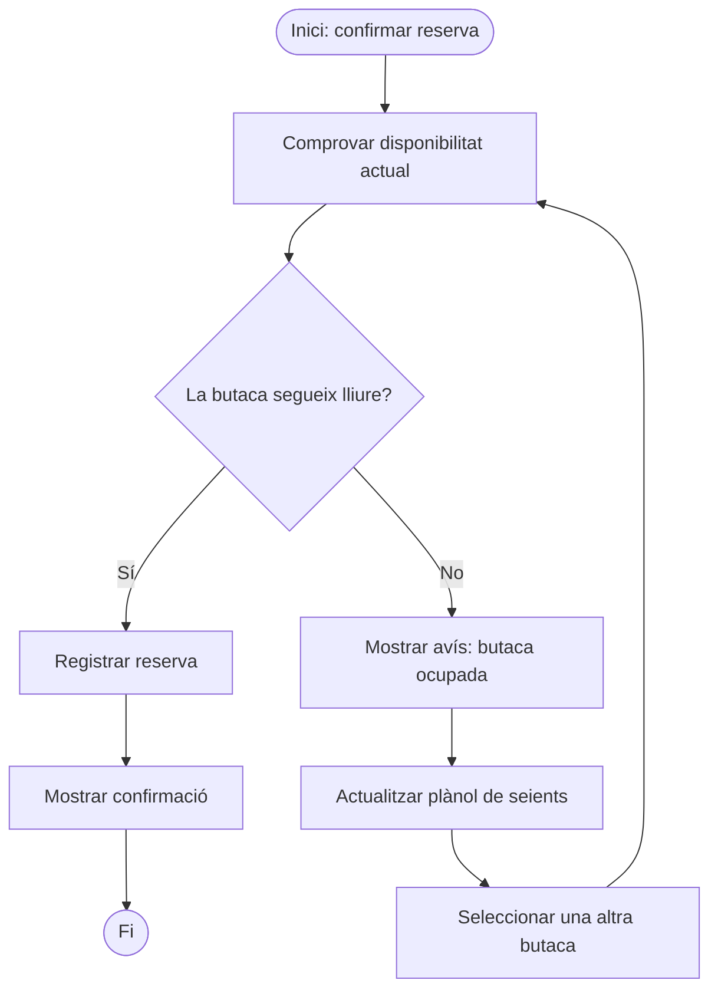

# TSDP2 · Entrega 1 · Tasca 6 — Diagrames de flux: «Què passaria si…?»

**Data límit de l'Entrega 1:** 30 d'octubre de 2026  
**Eina obligatòria:** Lucidchart  
**Modalitat:** primera part grupal, repte individual i posada en comú  
**Lliurament:** apartat 6 del dossier UX individual de Google Drive

## Per què fem aquesta activitat?

Un recorregut d'usuari no sempre segueix el camí ideal. Poden faltar dades, haver-hi conflictes de reserves, produir-se errors o aparèixer decisions imprevistes. Els **diagrames de flux** permeten anticipar aquestes situacions i decidir què ha de fer la plataforma en cada cas, **abans de programar-la**.

> **Repte:** primer dibuixareu com hauria de funcionar el procés principal; després cadascú haurà de respondre a la pregunta **«Què passaria si…?»** i proposar una solució clara.

## Objectius

- Representar un procés principal amb accions, decisions i resultats.
- Reconèixer la diferència entre el flux ideal i els camins alternatius (_corner cases_).
- Preveure missatges, validacions i retorns a passos anteriors.
- Distingir processos del **frontoffice** (usuari públic) i del **backoffice** (personal administrador).
- Comunicar les decisions amb diagrames digitals coherents i llegibles.

## Recordatori: símbols bàsics

| Símbol                    | Significat                     | Exemple                       |
| ------------------------- | ------------------------------ | ----------------------------- |
| Oval                      | Inici o final                  | «Inici de la reserva»         |
| Rectangle                 | Acció o procés                 | «Seleccionar dia i hora»      |
| Rombe                     | Decisió                        | «Hi ha disponibilitat?»       |
| Fletxa                    | Direcció del flux              | Tornar a seleccionar una hora |
| Paral·lelogram (opcional) | Entrada o sortida d'informació | «Mostrar missatge d'error»    |

**Important:** les sortides de les decisions han d'estar etiquetades (p. ex. «Sí» / «No»). Un mapa del lloc enumera pàgines; un diagrama de flux explica **què passa i en quin ordre**.

---

## Fase 1 · Diagrama principal de la web (en grup)

**Temps orientatiu:** 35 minuts.

1. Recupereu les funcionalitats de l'MVP i el mapa del lloc de les tasques 4 i 5.
2. Identifiqueu l'**acció principal** del vostre projecte:
   - **Rocanolich:** inscripció a una cursa.
   - **Estètica i perruqueria:** reserva d'una cita.
   - **Graduació:** reserva de butaques per als acompanyants.
3. Escriviu els passos del recorregut habitual, des de l'inici fins a la confirmació.
4. Dibuixeu un únic **diagrama grupal a Lucidchart**, amb les decisions indispensables.
5. Comproveu que qualsevol company pot explicar el procés seguint les fletxes.

**Resultat:** un diagrama del recorregut principal consensuat per l'equip. Aquest document serà el punt de partida dels reptes individuals.

### Exemple resumit: reserva de pàdel

`Inici → Seleccionar dia → Escollir pista i hora → Comprovar disponibilitat → Introduir dades → Confirmar → Mostrar confirmació → Fi`

Això és només una seqüència inicial: el diagrama digital ha d'incloure les decisions pertinents i les seves sortides.

---

## Fase 2 · Repte individual: «Què passaria si…?»

**Temps orientatiu:** 45 minuts.

Cada alumne rebrà **un cas límit** del seu projecte. Es repartiran els casos entre els membres de l'equip per evitar duplicacions sempre que sigui possible.

### Instruccions individuals

1. Llegeix el cas assignat i identifica **qui** està utilitzant la plataforma (usuari del frontoffice o administrador del backoffice).
2. Indica **en quin punt** del procés principal apareix la incidència.
3. Escriu la decisió necessària: **com detecta el sistema el problema?**
4. Decideix què veu o pot fer l'usuari: missatge, alternatives, correcció de dades, reintent o cancel·lació.
5. Dibuixa **el teu diagrama individual a Lucidchart** amb inici, passos, almenys una decisió i final o retorn al flux principal.
6. Afegeix una breu explicació de **per què has triat aquesta solució** i com evita confusions o errors.

**No n'hi ha prou amb posar «mostrar error».** Has d'explicar com pot continuar l'usuari, o per què el procés ha d'acabar.

### Reptes possibles — Rocanolich

| Núm. | Àrea        | Què passaria si…?                                                                                            |
| ---- | ----------- | ------------------------------------------------------------------------------------------------------------ |
| R1   | Frontoffice | L'usuari intenta inscriure's a una cursa amb les **places exhaurides**?                                      |
| R2   | Frontoffice | Deixa un **camp obligatori buit** o escriu una dada amb format incorrecte?                                   |
| R3   | Frontoffice | Intenta inscriure's **dues vegades a la mateixa modalitat**?                                                 |
| R4   | Frontoffice | El **pagament és rebutjat** o queda sense confirmar?                                                         |
| R5   | Frontoffice | Tanca la pàgina abans d'acabar i després **vol recuperar la inscripció**?                                    |
| R6   | Backoffice  | Un administrador intenta **modificar les dades d'un participant** i falten dades obligatòries?               |
| R7   | Backoffice  | Cal **cancel·lar una inscripció** que ja té un pagament registrat?                                           |
| R8   | Backoffice  | Dos administradors intenten **editar el mateix participant** gairebé al mateix temps?                        |
| R9   | Backoffice  | L'administrador vol **exportar la llista d'inscrits**, però no hi ha resultats amb els filtres seleccionats? |

### Reptes possibles — Estètica i perruqueria

| Núm. | Àrea        | Què passaria si…?                                                                                |
| ---- | ----------- | ------------------------------------------------------------------------------------------------ |
| E1   | Frontoffice | L'usuari selecciona una **hora que acaba d'ocupar una altra persona**?                           |
| E2   | Frontoffice | Intenta reservar fora de l'**horari d'obertura**?                                                |
| E3   | Frontoffice | Tria un servei i un professional que **no està disponible** aquell dia?                          |
| E4   | Frontoffice | Deixa les **dades de contacte incompletes**?                                                     |
| E5   | Frontoffice | Vol **canviar o cancel·lar una cita** quan ja és molt a prop l'hora reservada?                   |
| E6   | Backoffice  | El personal vol **bloquejar hores per vacances o absències** però ja hi ha cites?                |
| E7   | Backoffice  | Un administrador intenta crear una cita que **se solapa** amb una altra del mateix professional? |
| E8   | Backoffice  | Canvia la **durada d'un servei** i això afecta les cites posteriors?                             |
| E9   | Backoffice  | Una cita consta com a confirmada, però el client **no es presenta**?                             |

### Reptes possibles — Graduació

| Núm. | Àrea        | Què passaria si…?                                                                               |
| ---- | ----------- | ----------------------------------------------------------------------------------------------- |
| G1   | Frontoffice | Dues persones intenten reservar **l'última butaca disponible** al mateix temps?                 |
| G2   | Frontoffice | L'alumne intenta superar el **límit d'acompanyants** permès?                                    |
| G3   | Frontoffice | El **NIA introduït és incorrecte o no està autoritzat**?                                        |
| G4   | Frontoffice | L'usuari selecciona butaques, però la **sessió caduca** abans de confirmar?                     |
| G5   | Frontoffice | L'usuari necessita un **seient accessible** i no n'hi ha cap de disponible a la zona prevista?  |
| G6   | Backoffice  | L'administrador ha de **bloquejar una butaca** que apareix disponible però no es pot utilitzar? |
| G7   | Backoffice  | El personal detecta **dues reserves associades al mateix alumne** que vulneren les normes?      |
| G8   | Backoffice  | S'intenta **importar o actualitzar el plànol de seients** i falten dades d'una fila?            |
| G9   | Backoffice  | L'administrador necessita comprovar les reserves però el **servei de consulta no respon**?      |

> **Nota:** alguns casos impliquen polítiques del negoci (cancel·lacions, seients accessibles, límits de reserves). No inventeu una norma com si fos definitiva: proposeu una resposta i indiqueu quina decisió caldria validar amb el client o professorat.

### Exemple desenvolupat — Graduació G1

**Situació:** dues persones seleccionen l'última butaca lliure alhora.

**Possibles passos del diagrama:**

1. L'usuari selecciona la butaca.
2. Prem «Confirmar reserva».
3. El sistema **torna a comprovar** que la butaca segueix disponible.
4. **Decisió:** continua lliure?
   - **Sí:** registra la reserva i mostra la confirmació.
   - **No:** informa que ja està ocupada i ofereix tornar al plànol per seleccionar una altra butaca.
5. El recorregut acaba amb reserva confirmada o torna a la selecció.

**Decisió UX:** no s'ha de comunicar que una reserva està confirmada abans de tenir la confirmació real del sistema.

---

## Fase 3 · Posada en comú i integració (en grup)

**Temps orientatiu:** 30 minuts.

1. Cada alumne presenta el seu cas límit i explica breument la solució.
2. La resta de l'equip comprova si les decisions i els missatges són comprensibles.
3. Identifiqueu contradiccions entre els diferents diagrames (per exemple, dues maneres incompatibles de gestionar una cancel·lació).
4. Acordeu quins camins alternatius s'haurien d'incorporar al disseny final del producte.
5. Si cal, **actualitzeu el diagrama principal del grup** perquè representi millor el funcionament acordat.

---

## Què cal afegir al dossier individual de Google Drive?

Afegiu un apartat titulat **«6. Diagrames de flux de l'usuari»** dins del mateix dossier de l'Entrega 1. No cal crear un dossier nou.

1. **Diagrama grupal** del recorregut principal: captura o exportació llegible i enllaç al Lucidchart.
2. **Diagrama individual** del corner case assignat: número i títol del cas, captura o exportació i enllaç al Lucidchart.
3. **Justificació individual** (5–8 línies): on apareix el problema, com es detecta, què passa després i per què la solució és adequada per a l'usuari.
4. **Conclusions de la posada en comú:** dues observacions o millores acordades amb l'equip.

## Requisits mínims

- [ ] Un diagrama principal **grupal** a Lucidchart, amb recorregut coherent des de l'inici fins al resultat.
- [ ] Un diagrama de **cas límit individual** a Lucidchart, diferent del procés ideal.
- [ ] Cada diagrama té un inici i un final (o un retorn clar al procés principal), accions i fletxes amb direcció.
- [ ] El diagrama individual inclou almenys **una decisió** amb alternatives etiquetades.
- [ ] El problema es resol amb una resposta concreta: missatge, correcció, nova selecció, reintent o tancament justificat.
- [ ] S'indica si el cas correspon al **frontoffice** o al **backoffice**.
- [ ] S'adjunten al dossier **els dos diagrames**, amb exportacions/captures llegibles i enllaços als originals.
- [ ] Hi ha justificació individual i conclusions de la posada en comú.

## Com comprovarem la qualitat?

| Aspecte                    | Què es valorarà?                                              |
| -------------------------- | ------------------------------------------------------------- |
| Coherència del procés      | Els passos segueixen una seqüència lògica i completa          |
| Decisions i alternatives   | El diagrama mostra què passa a cada branca                    |
| Resolució de la incidència | L'usuari sap què ha passat i què pot fer després              |
| Claredat visual            | Formes, textos i fletxes es poden seguir sense explicacions   |
| Relació amb el projecte    | El cas té sentit segons les funcionalitats i normes definides |
| Documentació               | Diagrames i justificacions ben incorporats al dossier         |

## Ampliació voluntària

- Resol un segon corner case d'una **àrea diferent** de la que t'ha tocat (si has treballat frontoffice, tria backoffice, o a l'inrevés).
- Combina dos errors relacionats en un sol flux i indica com evites que l'usuari quedi atrapat en un bucle.
- Contrasta el teu diagrama amb una altra persona i incorpora una millora derivada de la prova.

**Recorda:** no es tracta de dibuixar moltes caixes; es tracta de demostrar que heu pensat què passarà quan la realitat no segueixi el guió perfecte.
